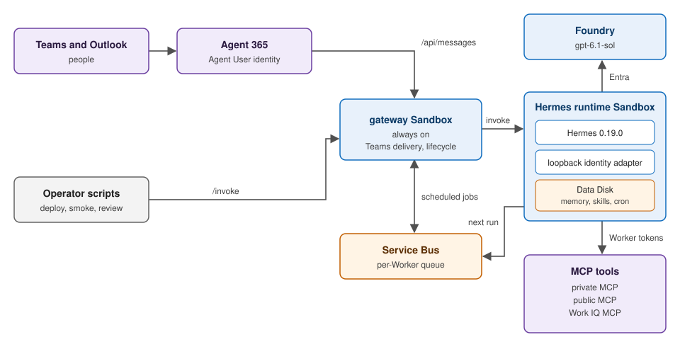

# Hermes on Azure

A Junior Project Manager digital Worker: Hermes 0.19.0 in Azure Container Apps Sandboxes, Microsoft Agent 365 for Teams and Microsoft 365, and Foundry `gpt-6.1-sol` with Entra-authenticated inference.

Each Worker owns its identity, persistent state, memory, and skills. Local learning becomes shared behavior only through signed Learning Packets, human-reviewed Git Promotion, and Worker Refresh.



## Start

From the repository root, with existing Worker state and an Azure login:

```powershell
Set-Location .\autopilots-on-azure
uv sync --frozen
uv run python -m scripts.demo_ops
uv run python -m scripts.demo_ops smoke --state-name hermes2 `
  --message "Reply exactly: Hermes ready" --timeout 600
```

The no-argument command checks the `hermes` Worker; the smoke test asks `hermes2` for a real model reply. `hermes2` also runs user scheduling and Service Bus Dreaming; `hermes` does not.

## Read next

| Document | Contents |
| --- | --- |
| [Deployment](DEPLOYMENT.md) | Worker updates, fresh Worker bootstrap, validation, diagnostics, teardown |
| [Demo](DEMO.md) | Prompts and observable results |
| [Specification](SPEC.md) | Domain, identity, lifecycle, learning, and current limitations |
| [Identity runbook](docs/runbooks/identity-mcp.md) | Consent, federation, and MCP troubleshooting |
| [Architecture decisions](docs/adr) | Current choices and rejected alternatives |
| [Architecture atlas](docs/architecture/autopilots-architecture.standalone.html) | Four interactive diagrams, offline-ready; [source](docs/architecture/autopilots-architecture.html) and [A3 PDF](docs/architecture/autopilots-architecture.pdf) |
| [Visual overview](docs/hermes-on-azure-overview.html) | Architecture and learning overview |
| [Architecture deep dive](docs/hermes-architecture-deep-dive.html) | Hosting, identity, and lifecycle |
| [Learning deep dive](docs/hermes-learning-deep-dive.html) | Memory, provenance, review, and refresh |

After editing the atlas source, rebuild its standalone HTML and PDF (needs Playwright with Chromium or Edge):

```powershell
node docs\architecture\assets\bundle.js docs\architecture\autopilots-architecture.html
node docs\architecture\assets\print-pdf.cjs docs\architecture\autopilots-architecture.standalone.html
```

## Boundaries

The gateway stays awake; runtime compute suspends after 30 idle minutes. Foundry registers an external agent, not Hosted Agent compute. `scripts.worker_lifecycle` creates and removes whole Workers; uploading the Teams package stays manual. Shared group conversations are not private storage. [SPEC.md](SPEC.md#current-limitations) lists all current limitations.
