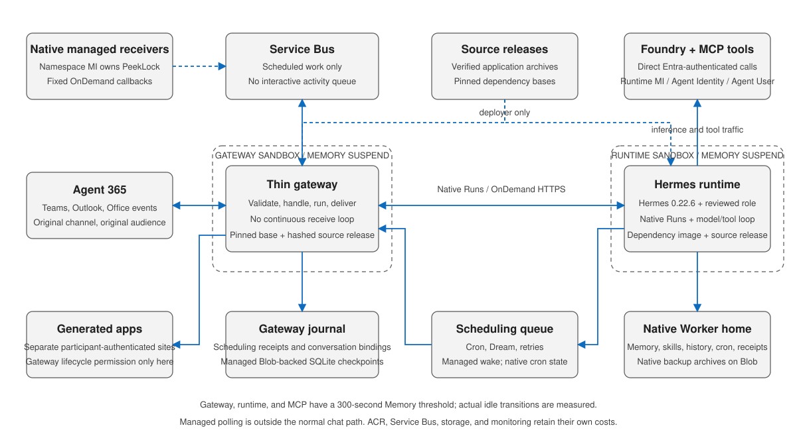

# Hermes on Azure

A Junior Project Manager digital Worker: Hermes 0.22.6 in Memory-suspended Azure Container Apps Sandboxes, Microsoft Agent 365 for Teams and Microsoft 365, native Service Bus wake, and Foundry `gpt-6.1-sol` with Entra-authenticated inference.

Each Worker owns its identity, persistent state, memory, and skills. Hermes learns natively; the Worker owner reviews each change, and local learning becomes shared behavior only through signed Learning Packets, human-reviewed Git Promotion, and Worker Refresh.

Workers can answer with [model-generated interactive HTML widgets](DEPLOYMENT.md#generated-html-widgets-and-hermes-selections). The [Agent Chat Simulator](chat-simulator/README.md) emulates the Teams channel so Workers can be [deployed and tested](docs/simulator-deployment.md) without Agent 365 or real Teams.



## Start

From the repository root, with existing Worker state and an Azure login:

```powershell
Set-Location .\autopilots-on-azure
uv sync --frozen
uv run python -m scripts.demo_ops
```

The no-argument command checks the `hermes` Worker. Validate model and tool behavior by messaging the Agent User in Teams; there is no general model-invocation HTTP endpoint. The deployment pins Hermes 0.22.6 with native learning, user scheduling, Service Bus Dreaming, scheduling receipts, and Blob-volume backups.

## Read next

Three architecture documents, each an interactive HTML page (hover or pin any diagram component) with an offline copy and a printable PDF:

| Document | Contents | Offline and print |
| --- | --- | --- |
| [Architecture](docs/architecture.html) | Operating model, conversation turns, identities, documents, state and recovery | [Standalone](docs/architecture.standalone.html), [PDF](docs/architecture.pdf) |
| [Collective learning](docs/collective-learning.html) | Memory layers, native learning and owner review, signed packets, Git Promotion, Worker Refresh | [Standalone](docs/collective-learning.standalone.html), [PDF](docs/collective-learning.pdf) |
| [Azure implementation](docs/azure-implementation.html) | Deployed topology, roles, Terraform layers, suspend behavior, telemetry, production network | [Standalone](docs/azure-implementation.standalone.html), [PDF](docs/azure-implementation.pdf) |

Then:

| Document | Contents |
| --- | --- |
| [Architecture decisions](docs/adr) | Current choices and rejected alternatives |
| [Deployment](DEPLOYMENT.md) | Worker updates, fresh Worker bootstrap, validation, diagnostics, teardown |
| [Simulator deployment](docs/simulator-deployment.md) | Isolated multi-Worker Sandbox deployment without Agent 365 or real Teams |
| [Demo](DEMO.md) | Prompts and observable results |
| [Agent Chat Simulator](chat-simulator/README.md) | Neutral collaboration UI, Entra sign-in and explicit expiring test-data demo mode |
| [Specification](SPEC.md) | Domain, identity, lifecycle, learning, and current limitations |
| [Identity runbook](docs/runbooks/identity-mcp.md) | Consent, federation, and MCP troubleshooting |

After editing a document, refresh, validate, bundle, and print it from `docs` (needs Playwright with Chromium or Edge):

```powershell
Set-Location docs
node assets\sync-head.js architecture.html
node assets\validate.js architecture.html
node assets\bundle.js architecture.html
node assets\export-pdf.js architecture.standalone.html
```

## Boundaries

Gateway, runtime, and both MCP services have a five-minute Memory-suspend threshold. Actual idle transitions are observed, not assumed. Teams activities are handled directly by the gateway, which calls native Runs over OnDemand HTTPS and polls native-run completion every 0.5 s. The per-Worker Service Bus queue is only for Hermes cron, Dreaming, and deterministic document retries; no interactive activity-recovery queue exists.

Routine source updates preserve compute IDs, URLs, and Agent 365 identities. Only the heavy runtime dependency base needs ACR; thin services use a pinned public Python image. Long model work enters through Agent 365/Teams rather than a separate operator API. Native backups recover the Worker home; a separate gateway journal preserves scheduling receipts and bounded conversation state. Stopped CPU/RAM is not a zero bill for storage, Service Bus, ACR, or monitoring.

Managed source polling can take tens of seconds, so it is deliberately outside the normal chat path. [ADR 0015](docs/adr/0015-service-bus-backed-hermes-cron.md#receiver-timing) records why the slower request/result-queue design was rejected.

On 2026-11-05, a real `hermes2` Teams warm check returned both MCP tool results in **26.7 s** and an exact model reply in **11.8 s**. These are observed end-to-end timings, not a model or platform SLA.

Foundry registers an external agent, not Hosted Agent compute. `scripts.worker_lifecycle` manages whole Workers; fresh Teams package upload stays manual. Shared group conversations are not private storage. [SPEC.md](SPEC.md#current-limitations) lists the remaining boundaries.

The simulator deployment is not fully accepted: on 2026-11-14 basic DEMO API login, a real model reply and file upload/download passed, but the deployed gateway returned an error during a transient native approval wait. The source repair preserves the same run until completion or deadline; it has not been rebuilt or deployed. The subsequent private browser attempt did not establish normal-TLS or widget acceptance. See [current validation status](docs/simulator-deployment.md#current-validation-status).
