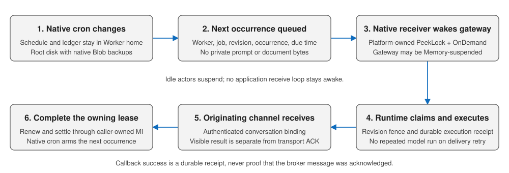

# ADR 0015: Native Hermes cron with managed Service Bus wake

## Decision

Keep native Hermes cron and its execution ledger in the Worker's Hermes home. An Azure `CronScheduler` plugin arms only the next occurrence in the per-Worker scheduling queue. A native managed connector receives it and invokes a fixed OnDemand callback; the gateway and runtime can both suspend to Memory between work.

Scheduling messages contain only type, Worker/job ID, revision, and due time. Private prompts, skills, results, and delivery credentials stay in backed-up actor state. Native cron sends as Agent Identity federated from runtime identity. The connector namespace identity receives; the gateway renews and completes through its own caller-owned connection and sends document retries with its managed identity. No SAS connection string is used.

Ordinary conversations run directly through the Agent 365 gateway and native Runs over OnDemand HTTPS. They do not publish activity payloads to Service Bus. The per-Worker scheduling queue remains reserved for native cron, Dreaming, and deterministic document retries; it is not a general prompt queue. The follow-up decision in [ADR 0023](0023-direct-teams-and-scheduling-only-service-bus.md) removes the previously added activity-recovery queue and operator invocation/polling API.

## Alternatives and rationale

| Alternative | Reason not selected |
| --- | --- |
| In-application periodic polling | Needs running actor compute; the native receiver instead owns source polling outside the actors. |
| One cloud scheduled job per user task | Duplicates native schedule state and creates resource churn. |
| Always-on gateway receive loop | Couples delivery to continuously running compute and prevents full idle suspension. |
| Custom always-on consumer/relay | Duplicates native managed connector wake and adds a service to operate. |
| Generic LLM prompt for document retries | Pays for reasoning where a fixed storage state machine is sufficient. |

## Correctness

- The native receiver owns PeekLock. Callback exit zero attests durable admission, not execution or ACK.
- The gateway-owned connection preserves lease ownership. Once a real lease arrives, renewal runs every 40 seconds and settlement follows durable work. Immediate processing before receipt never fabricates a lease. The queue lock is five minutes.
- The connector's callback identity has SandboxGroup Data Owner on the gateway group only; this is broader than execute-only and is an explicit platform tradeoff.
- Revision checks reject stale update/cancel messages even when cancellation races activation.
- Durable claims/output receipts prevent duplicate model execution; delivery retries reuse output.
- Teams sends are not atomic with receipt persistence. A crash in that window can duplicate the message.
- A failed or interrupted scheduled effect is quarantined rather than replayed. The gateway's own connection dead-letters the broker delivery while the journal retains the unknown outcome and error; settlement is not recorded as successful execution.
- Hosted jobs allow prompts/reviewed Role Skills, not arbitrary scripts or stored human delegation.
- Reserved `system.dream` uses fenced phases. Reconcile a durable completed response; stop on ambiguous `dream_started` rather than blindly rerun.
- Management-plane ad-hoc run-now is a separate occurrence and cannot advance production cron.
- Dreaming does not prepare a Learning Packet; preparation, approval, and export remain explicit owner operations.

Document publishing reuses this queue with fixed runtime APIs; [ADR 0019](0019-durable-document-publish-and-interactive-choice.md) defines its separate state machine.

## Receiver timing

Native wake removes application receive loops, not the connector service's source polling. The rejected three-hop design on 2026-11-05 waited 68-116 seconds before activity receipt and took 161-175 seconds per warm turn despite about 4-13 seconds of model work. Trigger metadata naming a ten-second interval did not attest that interval and was removed. The original decision kept direct interactive Runs with managed queues for scheduling and recovery; the follow-up in ADR 0023 removes the recovery path while preserving this queue for scheduled work.

The real direct-path warm check then returned the private incidents and public shipments tool results in 26.7 seconds, and a separate exact model reply in 11.84 seconds. Native billing/transcript evidence and unchanged exact replay were checked independently. This is measured behavior, not a universal SLA.
